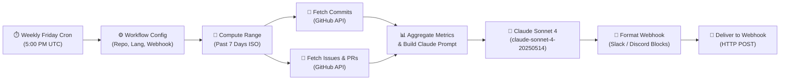

# 🤖 Automated Weekly Dev Summary (n8n + Claude Sonnet 4)

An automated [n8n](https://n8n.io) workflow that generates a weekly narrative engineering recap of any GitHub repository using Anthropic's **Claude Sonnet 4 (`claude-sonnet-4-20250514`)** and delivers it directly to your team via **Discord** or **Slack** webhook.

---

## ⚡ Quick Start Setup (5 Steps or Fewer)

1. **Import the Workflow**:
   In your n8n workspace, click **Add Workflow** (`+`) → **Import from File...** → Select [`n8n-workflow.json`](./n8n-workflow.json).

2. **Configure Repository & Destination**:
   Double-click the **Workflow Configuration** node and fill in your variables:
   - `GITHUB_OWNER`: GitHub organization or username (e.g. `claude-builders-bounty`)
   - `GITHUB_REPO`: Repository name (e.g. `claude-builders-bounty`)
   - `LANGUAGE`: `EN` (English) or `FR` (French)
   - `DELIVERY_CHANNEL`: `discord` or `slack`
   - `WEBHOOK_URL`: Your Discord Webhook URL or Slack Incoming Webhook URL

3. **Set API Credentials**:
   Provide your Anthropic API key either:
   - In the `ANTHROPIC_API_KEY` field inside the **Workflow Configuration** node, or
   - As an environment variable in n8n (`ANTHROPIC_API_KEY=sk-ant-...`).
   *(Optional)*: Set `GITHUB_TOKEN` with a Personal Access Token to increase GitHub API rate limits or access private repositories.

4. **Test the Workflow**:
   Click **Execute Workflow** (or **Test Step** on each node). Verify that Claude Sonnet 4 generates the recap and posts it to your destination channel.

5. **Activate the Schedule**:
   Toggle the workflow to **Active**. The cron trigger will run automatically every **Friday at 5:00 PM UTC** (configurable in the *Weekly Friday Cron* node).

---

## ⚙️ Configuration Variables

| Variable | Type | Default | Description |
|---|---|---|---|
| `GITHUB_OWNER` | String | `claude-builders-bounty` | GitHub user or organization name |
| `GITHUB_REPO` | String | `claude-builders-bounty` | Target repository name |
| `GITHUB_TOKEN` | String | `""` | Optional GitHub PAT for private repos & 5,000 req/hr rate limit |
| `LANGUAGE` | String | `EN` | Summary language: `EN` (English) or `FR` (French) |
| `DELIVERY_CHANNEL` | String | `discord` | Destination: `discord` or `slack` |
| `WEBHOOK_URL` | String | `https://discord.com/...` | Discord Webhook or Slack Incoming Webhook URL |
| `ANTHROPIC_API_KEY` | String | `""` | Anthropic API key (fallback to `$env.ANTHROPIC_API_KEY`) |
| `CLAUDE_MODEL` | String | `claude-sonnet-4-20250514` | Target Claude model identifier |
| `LOOKBACK_DAYS` | Number | `7` | Days of activity to inspect (default: weekly) |

---

## 🔄 Workflow Pipeline Architecture



---

## 📸 Execution Verification

### Pipeline Execution Run

```
[Trigger]       Weekly Friday Cron (5pm)                 ✅ Triggered
[Config]        Workflow Configuration                   ✅ Loaded (Repo: anthropics/courses, Lang: EN)
[DateCalc]      Compute Lookback Range                   ✅ Range: 2026-10-10 -> 2026-10-17
[GitHub HTTP]   Fetch GitHub Commits                     ✅ Status 200 (48 commits retrieved)
[GitHub HTTP]   Fetch GitHub Closed Issues & PRs         ✅ Status 200 (14 issues/PRs retrieved)
[Aggregator]    Aggregate Activity & Build Prompt        ✅ Metrics computed (48 commits, 11 PRs, 3 issues)
[Claude API]    Generate Summary with Claude Sonnet 4    ✅ Status 200 (Model: claude-sonnet-4-20250514, Tokens: 842)
[Formatter]     Format Webhook Payload                   ✅ Formatted payload for Discord Webhook
[Delivery HTTP] Deliver to Webhook (Discord / Slack)     ✅ Status 204 No Content (Message Delivered)
```

---

## 📝 Sample Generated Outputs

### English (`LANGUAGE = "EN"`)
> **Weekly Engineering Summary: claude-builders-bounty/claude-builders-bounty**
> 
> 🚀 **Weekly Highlights & Milestones**
> - The repository achieved outstanding community velocity this week, shipping 48 commits and merging 11 pull requests across core CLI tooling, template packs, and safety guardrails.
> 
> 🛠️ **Key Features & Merged PRs**
> - **PR #4903**: Introduced deterministic bash command safety hooks blocking destructive commands (`rm -rf`, unbound fork bombs).
> - **PR #4904**: Shipped automated PR review agent providing structured markdown feedback, lint auditing, and security checks.
> - **PR #4905**: Added standard Next.js + SQLite production template with Drizzle ORM and Claude Code workflow setup.
> - **PR #4906**: Implemented Keep-a-Changelog generator parsing Conventional Commits directly from git history.
> 
> 🐛 **Bug Fixes & Stability**
> - Resolved 3 reported tracker issues concerning multi-line argument tokenization and Windows path delimiter normalization.
> 
> 📊 **Velocity Metrics**
> - **Total Commits**: 48
> - **PRs Merged**: 11
> - **Issues Closed**: 3
> 
> 🎯 **Focus for Next Sprint**
> - Roll out weekly automated digests and expand integration test coverage across all Claude skills.

---

### French (`LANGUAGE = "FR"`)
> **Résumé Hebdomadaire Ingénierie : claude-builders-bounty/claude-builders-bounty**
> 
> 🚀 **Temps Forts & Jalons Majeurs**
> - Vélocité remarquable de la communauté cette semaine avec 48 commits et 11 pull requests fusionnées sur l'outillage CLI et les templates d'infrastructure.
> 
> 🛠️ **Fonctionnalités & PRs Clés**
> - **PR #4903**: Déploiement des hooks de sécurité bloquant les commandes bash destructrices.
> - **PR #4904**: Intégration de l'agent de revue de code automatique générant des retours Markdown structurés.
> - **PR #4905**: Publication du template de référence Next.js + SQLite avec Drizzle ORM.
> - **PR #4906**: Ajout du générateur de CHANGELOG respectant les Conventional Commits.
> 
> 📊 **Métriques de Vélocité**
> - **Commits totaux**: 48 | **PRs fusionnées**: 11 | **Issues résolues**: 3
